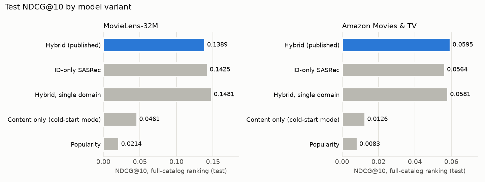

# OTT next-to-watch recommender (MovieLens-32M + Amazon Movies & TV)

Given what a viewer watched, in order, this model ranks **what they will watch next** over a
catalog of **285,528 movies and TV titles** from two sources:

- 87,585 MovieLens movies, with real TMDB metadata.
- 197,943 Amazon Movies & TV titles, about half of them Prime Video, including series such as
  *Justified*, *Vikings* and *Downton Abbey*.

It is a SASRec-style causal transformer. Each title's vector combines a learned ID embedding
with a projected [`BAAI/bge-base-en-v1.5`](https://huggingface.co/BAAI/bge-base-en-v1.5)
embedding of its metadata text. Because the ID part is randomly dropped during training, the
model can also rank **new titles described only by text** (cold start).

Code, data pipeline and training logs: <https://github.com/zackyalgiffari/ott-recommender-ml32m>

<!-- RESULTS:START -->
Model: [`zackyalgiffari/ott-recommender-ml32m`](https://huggingface.co/zackyalgiffari/ott-recommender-ml32m) — trained on a Google Colab NVIDIA L4 (bf16) in 161 minutes (torch 2.14.1, transformers 5.22.1), with the ID vectors of 3,522 titles that have no training events zeroed (see Method); best epoch 29 of 30 by mean validation NDCG@10.

Test set, **full-catalog ranking** within each domain (already-watched titles excluded); all values in %.

**MovieLens-32M** — 200,948 test users

| Model | Recall@10 | NDCG@10 | Recall@20 | NDCG@20 | MRR@20 | Coverage@10 |
|---|---:|---:|---:|---:|---:|---:|
| Hybrid — this model | **23.98** | **13.89** | **33.04** | **16.17** | **11.44** | **14.48** |
| Same model, content only (ID vectors off) | 8.14 | 4.61 | 11.41 | 5.43 | 3.76 | 9.11 |
| Ablation: ID-only SASRec | 24.59 | 14.25 | 33.76 | 16.56 | 11.73 | 13.32 |
| Ablation: hybrid trained on MovieLens-32M only | 25.38 | 14.81 | 34.62 | 17.14 | 12.23 | 15.14 |
| Variant: hybrid with ID-dropout 0.05 | 24.26 | 14.01 | 33.39 | 16.31 | 11.52 | 14.79 |
| Popularity baseline | 4.28 | 2.14 | 6.98 | 2.81 | 1.67 | 0.51 |

**Amazon Movies & TV** — 657,203 test users

| Model | Recall@10 | NDCG@10 | Recall@20 | NDCG@20 | MRR@20 | Coverage@10 |
|---|---:|---:|---:|---:|---:|---:|
| Hybrid — this model | **9.76** | **5.95** | **12.99** | **6.76** | **5.00** | **23.39** |
| Same model, content only (ID vectors off) | 2.35 | 1.26 | 3.37 | 1.52 | 1.00 | 65.46 |
| Ablation: ID-only SASRec | 9.12 | 5.64 | 12.10 | 6.39 | 4.78 | 20.50 |
| Ablation: hybrid trained on Amazon Movies & TV only | 9.53 | 5.81 | 12.74 | 6.62 | 4.89 | 34.29 |
| Variant: hybrid with ID-dropout 0.05 | 9.54 | 5.92 | 12.57 | 6.68 | 5.01 | 26.79 |
| Popularity baseline | 1.73 | 0.83 | 2.48 | 1.02 | 0.61 | 0.01 |

**Cold titles** — test targets that never occur in any training sequence (only content can rank them):

| Domain | Users | Hybrid R@20 | Content-only R@20 | Popularity R@20 |
|---|---:|---:|---:|---:|
| MovieLens-32M | 102 | 1.96 | 0.98 | 0.00 |
| Amazon Movies & TV | 907 | 1.98 | 1.65 | 0.00 |



<details><summary>Validation per epoch (20,000 sampled users per domain)</summary>

| Epoch | Train loss | MovieLens NDCG@10 | Amazon NDCG@10 | Mean | Train time |
|---:|---:|---:|---:|---:|---:|
| 1 | 6.0598 | 8.36 | 4.10 | 6.23 | 5 min |
| 2 | 5.4407 | 10.83 | 4.97 | 7.90 | 5 min |
| 3 | 5.3032 | 11.92 | 5.42 | 8.67 | 5 min |
| 4 | 5.2325 | 12.52 | 5.96 | 9.24 | 5 min |
| 5 | 5.1842 | 12.64 | 6.28 | 9.46 | 5 min |
| 6 | 5.1474 | 13.28 | 6.35 | 9.81 | 5 min |
| 7 | 5.1218 | 13.39 | 6.40 | 9.89 | 5 min |
| 8 | 5.0980 | 13.68 | 6.68 | 10.18 | 5 min |
| 9 | 5.0789 | 13.80 | 6.80 | 10.30 | 5 min |
| 10 | 5.0639 | 13.97 | 6.77 | 10.37 | 5 min |
| 11 | 5.0469 | 14.33 | 6.88 | 10.60 | 5 min |
| 12 | 5.0336 | 14.40 | 6.82 | 10.61 | 5 min |
| 13 | 5.0201 | 14.24 | 6.93 | 10.59 | 5 min |
| 14 | 5.0073 | 14.67 | 6.99 | 10.83 | 5 min |
| 15 | 4.9962 | 14.76 | 6.93 | 10.85 | 5 min |
| 16 | 4.9845 | 14.76 | 6.86 | 10.81 | 5 min |
| 17 | 4.9753 | 14.75 | 7.01 | 10.88 | 5 min |
| 18 | 4.9668 | 14.99 | 7.14 | 11.06 | 5 min |
| 19 | 4.9555 | 15.08 | 7.08 | 11.08 | 5 min |
| 20 | 4.9488 | 15.04 | 7.14 | 11.09 | 5 min |
| 21 | 4.9414 | 15.19 | 7.17 | 11.18 | 5 min |
| 22 | 4.9327 | 15.36 | 7.10 | 11.23 | 5 min |
| 23 | 4.9282 | 15.33 | 7.20 | 11.27 | 5 min |
| 24 | 4.9211 | 15.35 | 7.04 | 11.19 | 5 min |
| 25 | 4.9189 | 15.36 | 7.22 | 11.29 | 5 min |
| 26 | 4.9140 | 15.41 | 7.26 | 11.33 | 5 min |
| 27 | 4.9103 | 15.55 | 7.26 | 11.41 | 5 min |
| 28 | 4.9077 | 15.49 | 7.29 | 11.39 | 5 min |
| 29 | 4.9082 | 15.56 | 7.28 | 11.42 | 5 min |
| 30 | 4.9034 | 15.55 | 7.25 | 11.40 | 5 min |

</details>
<!-- RESULTS:END -->

### Findings

- **Personalisation works.** On the full catalog, the hybrid's NDCG@10 is **6.5×** the
  popularity baseline's on MovieLens and **7.2×** on Amazon. Its top-10 lists cover 14.5% and
  23.4% of the two catalogs; popularity covers 0.5% and 0.01%.
- **Training on both sources is a trade-off, not a free win.** On sparse **Amazon**, the
  two-source model beats an Amazon-only model (5.95 vs 5.81 NDCG@10, +2.4%). On dense
  **MovieLens**, a MovieLens-only model is better (14.81 vs 13.89, −6.2% for the shared
  model): one 2-layer network shares its capacity between two very different user
  populations. If you serve only one catalog, train on that catalog alone with
  `python -m src.train --domains <name>`.
- **Content vectors help where IDs are weak.** ID-only SASRec is slightly better on MovieLens
  (14.25 vs 13.89). The hybrid is better on Amazon (5.95 vs 5.64), where many titles have few
  interactions. Only the hybrid can rank titles it has never seen.
- **Cold start is real but modest.** Test targets that never occur in training reach about 2%
  Recall@20, where popularity and ID-only models reach 0%. In content-only mode, with every ID
  vector off, the model still achieves 2.2× (MovieLens) and 1.5× (Amazon) the popularity
  baseline's NDCG@10.
- **Why ID-dropout 0.2 and not 0.05.** A variant with ID-dropout 0.05 scores 0.5–1.5% higher
  on known titles (validation), but its content-only ranking collapses, to below popularity on
  MovieLens. The released model keeps 0.2, so recommending new titles from their description
  stays useful. The 0.05 weights are on the
  [`id-dropout-0.05`](https://huggingface.co/zackyalgiffari/ott-recommender-ml32m/tree/id-dropout-0.05)
  branch.
- **Provenance.** Hybrid metrics are for the released weights, evaluated in fp32. The
  content-only and popularity rows were evaluated in bf16 on the training GPU. The
  single-domain and 0.05 runs used an A100; everything else used an L4. Hyper-parameters are
  identical throughout.


## How to use

```python
import sys
from huggingface_hub import snapshot_download

path = snapshot_download("zackyalgiffari/ott-recommender-ml32m")
sys.path.insert(0, path)
from recommend import OTTRecommender

rec = OTTRecommender(path)            # device="cuda" if available
rec.recommend(["The Matrix (1999)", "Toy Story (1995)", "Inception (2010)"], domain="movielens", k=10)
rec.recommend(["Justified", "Vikings", "The Tomorrow War"], domain="amazon", k=10)

# Cold start: score titles that are not in the catalog, from their text alone
rec.rank_new_titles(
    ["The Matrix (1999)", "Inception (2010)"],
    ["Dune: Part Two (2024). Genres: Sci-Fi, Adventure. Paul Atreides unites with the Fremen ...",
     "The Holiday Romance (2024). Genres: Comedy, Romance. Two strangers swap homes ..."],
    domain="movielens",
)
```

Command line, from a clone of the repo or a downloaded snapshot:

```bash
pip install -r requirements.txt
python recommend.py --domain movielens "The Matrix (1999)" "Toy Story (1995)" "Inception (2010)"
```

History entries can be catalog titles (`"Title (Year)"`; fuzzy matching is applied), item ids
such as `ml:2571` / `az:B00005JNQV`, or integer item indices. Recommendations are ranked within
the chosen domain's catalog, and already-watched titles are excluded.

| File | Content |
|---|---|
| `config.json`, `model.safetensors` | model hyper-parameters and weights (`PyTorchModelHubMixin`) |
| `item_content.safetensors` | frozen bge-base embeddings of every catalog title (float16) |
| `catalog.parquet` | `item_idx`, domain, source id, title, year, genres, format, training popularity |
| `modeling.py`, `recommend.py` | self-contained model class and inference helper |
| `results/` | data report, test metrics, training history, ablations |

## Data

| Source | Use |
|---|---|
| [MovieLens-32M](https://huggingface.co/datasets/hazemessam/ml-32m) | 32,000,204 ratings by 200,948 users (1995–2023), used as watch events |
| [TMDB movie dump](https://huggingface.co/datasets/ada-datadruids/full_tmdb_movies_dataset) | overview, tagline, keywords, languages and runtime for 86,337 MovieLens movies |
| [Amazon Reviews 2023, Movies & TV](https://huggingface.co/datasets/McAuley-Lab/Amazon-Reviews-2023) | 5-core: 7,441,129 reviews by 657,203 users (1997–2023), plus item metadata |

Data-quality steps (all recorded in `results/data_report.json`):

- **MovieLens integrity.** The MD5 of every CSV matches the official `checksums.txt`, and the
  rating, movie and user counts equal the published ones.
- **Validated TMDB join.** TMDB metadata is attached only when MovieLens's `imdbId` agrees with
  TMDB's `imdb_id`. This rejected 148 wrong `tmdbId` links. In total 98.6% of movies got
  validated metadata.
- **No future information.** All-time aggregates (Amazon `average_rating` / `rating_number`,
  MovieLens tags) are not used as features.
- **Amazon titles.** 82,840 Prime Video items have no title or description in the source
  metadata. They are kept, because they are in many users' histories, and are represented by
  director, cast, content advisory and language. In the catalog they appear as
  `Untitled Prime Video item (dir. …)`.

## Training

- **Split.** Per-user leave-last-out by timestamp. Test = last event, validation =
  second-to-last, training = the rest; ties are broken by item index. The split's SHA-256 is
  reported, so runs are verifiable.
- **Architecture.** 2 pre-LN transformer blocks, d = 256, 4 heads, dropout 0.2. Domain and
  position embeddings. Histories are up to 200 (MovieLens) or 50 (Amazon) titles long.
- **Item vectors.** `W · bge(text) + E_id`, with ID-dropout p = 0.2.
- **Objective.** Next-title sampled softmax with 8,192 uniform negatives from the same domain.
  Every batch holds a single domain.
- **Optimisation.** AdamW (lr 1e-3, warm-up, cosine decay), bf16, 25,600 tokens per batch.
  Early stopping on mean validation NDCG@10 (patience 3).
- **Cold-title ID reset.** The 3,522 titles with no training events have their ID vectors
  zeroed in the published weights. They were seen only as sampled negatives, so their ID
  vectors had learned to push them down; with the reset they are ranked by content alone. On
  validation, warm metrics did not change, and cold-title Recall@20 on Amazon rose from 0% to
  3.9%.
- **Hardware.** Google Colab, launched with the `colab` CLI. The main model was trained on an
  NVIDIA L4 (about 11 steps/s, 5.4 min per epoch). The later candidate and single-domain
  ablations ran on an A100 (about 41 steps/s), with identical hyper-parameters.

## Evaluation

For every user, the held-out title is ranked against the **entire catalog of its domain**
(87,585 or 197,943 titles), excluding titles the user already watched. No sampled candidate
lists are used. Reported: Recall@10/20, NDCG@10/20, MRR@20, catalog coverage@10, and the
same metrics on *cold* targets that never appear in training.

## Limitations

- **Ratings and reviews stand in for views.** MovieLens ratings and Amazon reviews are proxies
  for viewing. Many Amazon items are DVD/Blu-ray products, not streams.
- **Popularity bias.** Both sources over-represent popular and English-language titles. Plan
  for re-ranking if diversity matters.
- **Leave-last-out timing.** Every user's last event is the test target. Different users' test
  events come from different years, so this split is not a strict global-time split.
- **No cross-domain merging.** A movie that exists in both catalogs is two separate items.
- **English text encoder.** Metadata for non-English titles is embedded with an English
  model, so content similarity is weaker for those titles.

## License and attribution

The model is released under **CC BY-NC 4.0** because it is derived from MovieLens (research,
non-commercial), Amazon Reviews 2023 (research use) and TMDB metadata. This product uses
TMDB data but is not endorsed or certified by TMDB.

- F. Maxwell Harper and Joseph A. Konstan. 2015. *The MovieLens Datasets: History and
  Context.* ACM TiiS 5(4).
- Yupeng Hou, Jiacheng Li, Zhankui He, An Yan, Xiusi Chen, Julian McAuley. 2024. *Bridging
  Language and Items for Retrieval and Recommendation.* arXiv:2403.03952.
- Wang-Cheng Kang and Julian McAuley. 2018. *Self-Attentive Sequential Recommendation.* ICDM.
- Shitao Xiao et al. 2023. *C-Pack: Packaged Resources to Advance General Chinese Embedding*
  (BGE). arXiv:2309.07597.
