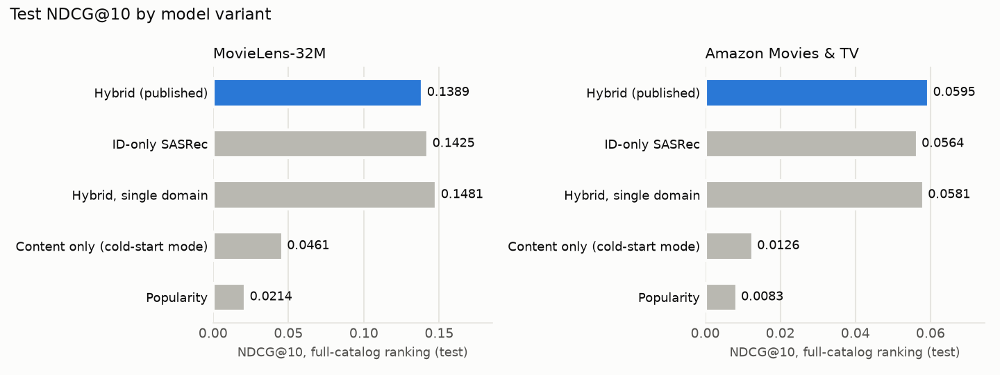

# ott-recommender-ml32m

A **next-to-watch recommender for OTT catalogs**, trained on two public sources from the
Hugging Face Hub: **MovieLens-32M** (with real TMDB metadata) and **Amazon Reviews 2023 —
Movies & TV** (movies and TV series, about half of them Prime Video titles). Training runs on
a Google Colab **L4** GPU through the [`colab` CLI](https://pypi.org/project/google-colab-cli/).

The model is a SASRec-style causal transformer over a user's watch history. Every title is
represented by a learned ID vector **plus** a projected text embedding of its metadata from
[`BAAI/bge-base-en-v1.5`](https://huggingface.co/BAAI/bge-base-en-v1.5). Because the ID part
is randomly dropped during training, the content path also works alone, so the model can
recommend brand-new titles from their description (cold start).

Model on the Hub: [`zackyalgiffari/ott-recommender-ml32m`](https://huggingface.co/zackyalgiffari/ott-recommender-ml32m)

## Results

<!-- RESULTS:START -->
Model: [`zackyalgiffari/ott-recommender-ml32m`](https://huggingface.co/zackyalgiffari/ott-recommender-ml32m) — trained on a Google Colab NVIDIA L4 (bf16) in 161 minutes (torch 2.14.1, transformers 5.22.1), with the ID vectors of 3,522 titles that have no training events zeroed (see Method); best epoch 29 of 30 by mean validation NDCG@10.

Test set, **full-catalog ranking** within each domain (already-watched titles excluded); all values in %.

**MovieLens-32M** — 200,948 test users

| Model | Recall@10 | NDCG@10 | Recall@20 | NDCG@20 | MRR@20 | Coverage@10 |
|---|---:|---:|---:|---:|---:|---:|
| Hybrid — this model | **23.98** | **13.89** | **33.04** | **16.17** | **11.44** | **14.48** |
| Same model, content only (ID vectors off) | 8.14 | 4.61 | 11.41 | 5.43 | 3.76 | 9.11 |
| Ablation: ID-only SASRec | 24.59 | 14.25 | 33.76 | 16.56 | 11.73 | 13.32 |
| Ablation: hybrid trained on MovieLens-32M only | 25.38 | 14.81 | 34.62 | 17.14 | 12.23 | 15.14 |
| Variant: hybrid with ID-dropout 0.05 | 24.26 | 14.01 | 33.39 | 16.31 | 11.52 | 14.79 |
| Popularity baseline | 4.28 | 2.14 | 6.98 | 2.81 | 1.67 | 0.51 |

**Amazon Movies & TV** — 657,203 test users

| Model | Recall@10 | NDCG@10 | Recall@20 | NDCG@20 | MRR@20 | Coverage@10 |
|---|---:|---:|---:|---:|---:|---:|
| Hybrid — this model | **9.76** | **5.95** | **12.99** | **6.76** | **5.00** | **23.39** |
| Same model, content only (ID vectors off) | 2.35 | 1.26 | 3.37 | 1.52 | 1.00 | 65.46 |
| Ablation: ID-only SASRec | 9.12 | 5.64 | 12.10 | 6.39 | 4.78 | 20.50 |
| Ablation: hybrid trained on Amazon Movies & TV only | 9.53 | 5.81 | 12.74 | 6.62 | 4.89 | 34.29 |
| Variant: hybrid with ID-dropout 0.05 | 9.54 | 5.92 | 12.57 | 6.68 | 5.01 | 26.79 |
| Popularity baseline | 1.73 | 0.83 | 2.48 | 1.02 | 0.61 | 0.01 |

**Cold titles** — test targets that never occur in any training sequence (only content can rank them):

| Domain | Users | Hybrid R@20 | Content-only R@20 | Popularity R@20 |
|---|---:|---:|---:|---:|
| MovieLens-32M | 102 | 1.96 | 0.98 | 0.00 |
| Amazon Movies & TV | 907 | 1.98 | 1.65 | 0.00 |



<details><summary>Validation per epoch (20,000 sampled users per domain)</summary>

| Epoch | Train loss | MovieLens NDCG@10 | Amazon NDCG@10 | Mean | Train time |
|---:|---:|---:|---:|---:|---:|
| 1 | 6.0598 | 8.36 | 4.10 | 6.23 | 5 min |
| 2 | 5.4407 | 10.83 | 4.97 | 7.90 | 5 min |
| 3 | 5.3032 | 11.92 | 5.42 | 8.67 | 5 min |
| 4 | 5.2325 | 12.52 | 5.96 | 9.24 | 5 min |
| 5 | 5.1842 | 12.64 | 6.28 | 9.46 | 5 min |
| 6 | 5.1474 | 13.28 | 6.35 | 9.81 | 5 min |
| 7 | 5.1218 | 13.39 | 6.40 | 9.89 | 5 min |
| 8 | 5.0980 | 13.68 | 6.68 | 10.18 | 5 min |
| 9 | 5.0789 | 13.80 | 6.80 | 10.30 | 5 min |
| 10 | 5.0639 | 13.97 | 6.77 | 10.37 | 5 min |
| 11 | 5.0469 | 14.33 | 6.88 | 10.60 | 5 min |
| 12 | 5.0336 | 14.40 | 6.82 | 10.61 | 5 min |
| 13 | 5.0201 | 14.24 | 6.93 | 10.59 | 5 min |
| 14 | 5.0073 | 14.67 | 6.99 | 10.83 | 5 min |
| 15 | 4.9962 | 14.76 | 6.93 | 10.85 | 5 min |
| 16 | 4.9845 | 14.76 | 6.86 | 10.81 | 5 min |
| 17 | 4.9753 | 14.75 | 7.01 | 10.88 | 5 min |
| 18 | 4.9668 | 14.99 | 7.14 | 11.06 | 5 min |
| 19 | 4.9555 | 15.08 | 7.08 | 11.08 | 5 min |
| 20 | 4.9488 | 15.04 | 7.14 | 11.09 | 5 min |
| 21 | 4.9414 | 15.19 | 7.17 | 11.18 | 5 min |
| 22 | 4.9327 | 15.36 | 7.10 | 11.23 | 5 min |
| 23 | 4.9282 | 15.33 | 7.20 | 11.27 | 5 min |
| 24 | 4.9211 | 15.35 | 7.04 | 11.19 | 5 min |
| 25 | 4.9189 | 15.36 | 7.22 | 11.29 | 5 min |
| 26 | 4.9140 | 15.41 | 7.26 | 11.33 | 5 min |
| 27 | 4.9103 | 15.55 | 7.26 | 11.41 | 5 min |
| 28 | 4.9077 | 15.49 | 7.29 | 11.39 | 5 min |
| 29 | 4.9082 | 15.56 | 7.28 | 11.42 | 5 min |
| 30 | 4.9034 | 15.55 | 7.25 | 11.40 | 5 min |

</details>
<!-- RESULTS:END -->

### Findings

- **Personalisation works.** On the full catalog, the hybrid's NDCG@10 is **6.5×** the
  popularity baseline's on MovieLens and **7.2×** on Amazon. Its top-10 lists cover 14.5% and
  23.4% of the two catalogs; popularity covers 0.5% and 0.01%.
- **Training on both sources is a trade-off, not a free win.** On sparse **Amazon**, the
  two-source model beats an Amazon-only model (5.95 vs 5.81 NDCG@10, +2.4%). On dense
  **MovieLens**, a MovieLens-only model is better (14.81 vs 13.89, −6.2% for the shared
  model): one 2-layer network shares its capacity between two very different user
  populations. If you serve only one catalog, train on that catalog alone with
  `python -m src.train --domains <name>`.
- **Content vectors help where IDs are weak.** ID-only SASRec is slightly better on MovieLens
  (14.25 vs 13.89). The hybrid is better on Amazon (5.95 vs 5.64), where many titles have few
  interactions. Only the hybrid can rank titles it has never seen.
- **Cold start is real but modest.** Test targets that never occur in training reach about 2%
  Recall@20, where popularity and ID-only models reach 0%. In content-only mode, with every ID
  vector off, the model still achieves 2.2× (MovieLens) and 1.5× (Amazon) the popularity
  baseline's NDCG@10.
- **Why ID-dropout 0.2 and not 0.05.** A variant with ID-dropout 0.05 scores 0.5–1.5% higher
  on known titles (validation), but its content-only ranking collapses, to below popularity on
  MovieLens. The released model keeps 0.2, so recommending new titles from their description
  stays useful. The 0.05 weights are on the
  [`id-dropout-0.05`](https://huggingface.co/zackyalgiffari/ott-recommender-ml32m/tree/id-dropout-0.05)
  branch.
- **Provenance.** Hybrid metrics are for the released weights, evaluated in fp32. The
  content-only and popularity rows were evaluated in bf16 on the training GPU. The
  single-domain and 0.05 runs used an A100; everything else used an L4. Hyper-parameters are
  identical throughout.


## Data

| Source (HF Hub) | What it contributes |
|---|---|
| [`hazemessam/ml-32m`](https://huggingface.co/datasets/hazemessam/ml-32m) | 32,000,204 ratings by 200,948 users on 87,585 movies (1995–2023), used as watch events |
| [`ada-datadruids/full_tmdb_movies_dataset`](https://huggingface.co/datasets/ada-datadruids/full_tmdb_movies_dataset) | Plot overview, keywords, languages and runtime for MovieLens titles |
| [`McAuley-Lab/Amazon-Reviews-2023`](https://huggingface.co/datasets/McAuley-Lab/Amazon-Reviews-2023) | Movies & TV 5-core: 7,441,129 reviews by 657,203 users on 197,943 titles, plus item metadata |

Every source is pinned to a commit (`src/config.py`). `src/prepare.py` checks data quality
and records every check in [`results/data_report.json`](results/data_report.json):

- **MovieLens integrity.** The MD5 of every CSV must match the official `checksums.txt`, and
  the rating, movie and user counts must equal the numbers published in the release README.
- **Validated TMDB join.** A TMDB record is attached only when MovieLens's `imdbId` matches
  TMDB's `imdb_id`. This catches 148 wrong `tmdbId` links in MovieLens itself. Records without
  an IMDb id need an identical normalised title and a year within ±1.
- **No future information in features.** Amazon's `average_rating` / `rating_number` and
  MovieLens tags are aggregates over all time, including the held-out events, so they are
  **not** used.
- **Deterministic split.** Per-user leave-last-out by timestamp, with ties broken by item index.
  The SHA-256 of the split arrays is reported, so a Colab run can be checked against a local one.

## Method

```
item vector   v_i = W · bge(text_i) + E_id[i]          (ID part dropped with p = 0.2 while training)
user state    h_u = Transformer(v_{i1} + pos_1 + dom, ..., v_{in} + pos_n + dom)[last]
score         s(u, i) = <h_u, v_i>                     (ranked within the user's domain catalog)
```

- 2 pre-LN transformer blocks, d = 256, 4 heads, dropout 0.2. History windows are up to 200
  (MovieLens) or 50 (Amazon) titles long.
- Sampled softmax with 8,192 uniform negatives from the same domain. Each batch holds a single
  domain, so the model never learns the trivial "which catalog is this" signal.
- **Cold-title ID reset.** Titles with no training events are seen only as sampled negatives,
  so their ID vectors learn to push them down. The published weights zero those 3,522 ID
  vectors, so such titles are ranked by content alone, which is the path ID-dropout trains.
  On validation this left NDCG@10 unchanged to five decimals and lifted cold-title Recall@20
  on Amazon from 0% to 3.9%.
- Evaluation ranks the held-out title against the **full catalog** of its domain, with
  already-watched titles removed. No sampled-candidate metrics are used.

## Reproduce

```bash
uv venv ~/.venvs/ott-prediction-model --python 3.12
uv pip install --python ~/.venvs/ott-prediction-model/bin/python torch --index-url https://download.pytorch.org/whl/cpu
uv pip install --python ~/.venvs/ott-prediction-model/bin/python -r requirements.txt pytest
python -m pytest -q                                       # unit tests

python -m src.prepare                                     # data + data_report.json (CPU, ~1 min)
scripts/colab_train.sh smoke                              # end-to-end check on a Colab L4
scripts/colab_train.sh full --push-to-hub <user>/<repo>   # full training run
scripts/colab_train.sh ablations                          # ID-only / single-domain models
GPU=A100 scripts/colab_train.sh ablations amazon_only     # pick the GPU and a subset of ablations

python -m src.evaluate --model outputs/best --reset-cold-ids   # evaluate the released variant
python -m src.package --model-dir outputs/best --reset-cold-ids --push-to-hub <user>/<repo>
python -m src.report --run-note "..."                     # regenerate the results tables in the docs
```

`scripts/colab_train.sh` packs the repo, starts the job detached on the VM, and polls it.
Every `colab exec` call is bounded by a timeout, and the launch is retried until the job's log
exists. It downloads `results/` into `runs/<session>/` and always stops the VM. On an L4 one
epoch takes about 5.4 min (11 steps/s); on an A100, about 1.5 min (41 steps/s).

| Stage | Module |
|---|---|
| download + MD5 verification | `src/download.py` |
| cleaning, TMDB join, item texts, split | `src/prepare.py` |
| text embeddings (bge-base) | `src/embed_items.py` |
| model | `src/model.py` |
| training | `src/train.py` |
| full-catalog evaluation | `src/evaluate.py`, `src/metrics.py` |
| Hub packaging | `src/package.py` |
| inference / demo | `src/recommend.py` |

## License

Code: MIT. The trained model and its catalog derive from MovieLens (non-commercial research
use), Amazon Reviews 2023 (research use) and TMDB metadata, so the model is released under
**CC BY-NC 4.0**.
